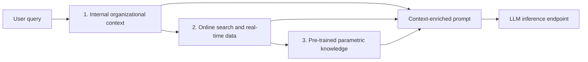

# Grounding AI models in verified enterprise data for high-accuracy execution

This pipeline grounds a general-purpose language model in an organization's own documents. Policies, SOPs, reports, and wikis are chunked, embedded, and stored in a local ChromaDB index. At question time the index is searched first. Only when that evidence is missing or incomplete does the answer fall through to live web search, and only then to the model's pre-trained knowledge.

The script in `rag_pipeline.py` does the organizational half of that design: ingest, embed, retrieve, and assemble a context-enriched prompt. A separate inference endpoint — Cursor or OpenClaw, running DeepSeek-R1, Qwen, or Llama 3 — receives that prompt and writes the answer. Document text is embedded into the vector index. Model weights are not retrained when the files change.

## Priority cascade

A user question enters a fixed order. Internal evidence outranks the open web, and the open web outranks parametric memory.

1. **Internal organizational context (primary).** ChromaDB is searched for the nearest document chunks. Those passages ground the model in factual enterprise text, and each passage keeps the source file name and chunk index.
2. **Online search runs only with approval.** If the retrieved context is missing, incomplete, or the question needs a current fact, the inference endpoint is instructed to use web search only after approval. 
3. **Pre-trained parametric knowledge (last resort).** General reasoning fills gaps that neither the index nor a live search covers.

When retrieved evidence cannot support a conclusion, the run records that. `SimpleRAGAgent.self_correct()` scores lexical overlap between the assembled prompt and the retrieved passages and sets `supported` and `needs_rephrase`. A thin overlap means the agent should stop leaning on the index and either rephrase or move down the cascade, rather than invent a citation.

## Two strategies, and the hybrid that uses both

| | Strategy 1 — Retrieval-augmented generation | Strategy 2 — Enterprise fine-tuning |
|---|---|---|
| What it changes | The evidence in the prompt | The model's weights, tone, and terminology |
| What it is good at | Factual accuracy, fresh knowledge, source traceability | Behavior, persona, and house style |
| Strengths | Updates by dropping in new files. Access stays on the local index. Every passage names its source. | Deep customization. Low latency once the weights are static. |
| Limits | The answer is only as good as retrieval. The prompt has a context window. | Can still hallucinate. Training and every retrain are expensive. |

**The enterprise ideal is the hybrid.** Use RAG to pull up-to-date facts from documents. Use light fine-tuning only for tone, structure, and branding. This repository implements the RAG side: documents are chunked and embedded into ChromaDB without a training run. Adapting model weights is a separate job and is not part of `rag_pipeline.py`.

## Why Internal Context Comes First

Organizations keep a local knowledge base because the facts change faster than a training cycle.

**Dynamic data, instant sync.** When a policy, price, or SOP changes, the updated file is dropped into the reports directory and the pipeline is run again. New chunks are added to ChromaDB in the same run. No GPU retraining is required for a knowledge update.

**Grounded answers with a source.** Retrieved passages are attached to the prompt as `[Source: filename]` blocks. The index stores the source file, chunk index, and extension with every vector, so an answer can be traced to the document it came from.

**Local-first knowledge base.** PDFs, HTML, Word files, text, and Markdown land in one on-disk Chroma collection. Privacy follows the whole path: files stay in the reports directory you configure, vectors stay in the index directory you configure, and the prompt is what leaves this process for the inference endpoint. Hosting the index locally does not by itself make the model call private. That depends on where Cursor or OpenClaw sends the prompt.

## How a run works

`python rag_pipeline.py` loads settings from `.env`, then walks five steps.

1. **Ingest.** `ingest_documents()` walks `RAG_REPORTS_DIR`, skips excluded directories and extensions, and reads HTML, PDF, DOCX, TXT, and Markdown.
2. **Chunk.** Each document is split into windows of `RAG_CHUNK_SIZE` characters with `RAG_CHUNK_OVERLAP` characters of overlap. A chunk id is `{stem}_chunk_{index}_{filename}`.
3. **Embed and store.** `embed_and_store()` loads `all-MiniLM-L6-v2`, encodes chunks in batches of 32, and `add`s them to the persistent Chroma collection. Existing ids are left in place. See below.
4. **Retrieve.** The same embedding model encodes the question. Chroma returns the nearest `RAG_TOP_K` chunks with document text, metadata, and distance.
5. **Prompt.** `SimpleRAGAgent` deduplicates those chunks and builds the system-and-user prompt: organizational context first, then the question, with explicit instructions for the web-search fallback and the parametric last resort.

The interactive loop prints the plan, how many chunks came back, the overlap confidence, and the prompt. Type `exit` to stop. The script does not call DeepSeek, Qwen, or Llama itself.

## Ingestion rules

| Rule | What the pipeline does |
|---|---|
| Skip rules | A path is skipped when any directory component is `.venv`, `.git`, `__pycache__`, `node_modules`, `.DS_Store`, or `.vs`. Shortcut files (`.lnk`, `.url`), bytecode (`.pyc`, `.pyo`, `.pyd`), binaries, images, and archives are skipped by extension. Matching is case-insensitive. |
| Multi-format ingestion | HTML, PDF, DOCX, TXT, and Markdown are read. HTML is stripped of script, style, and tags. PDF uses PyMuPDF. DOCX uses `python-docx` paragraph text. Markdown heading and emphasis markers are removed. **CSV is excluded** and is not in the allowed extension list. |
| Incremental updates | The Chroma collection is opened with `get_or_create_collection` on the existing on-disk index. `collection.add` inserts new chunk ids and does not delete what is already stored. A later run keeps existing chunks and adds chunks whose ids are not in the collection yet. |
| Embedding model | `all-MiniLM-L6-v2` through Sentence Transformers. It is an open-source model. Queries and documents are embedded with the same model so they occupy one vector space. Override the name with `RAG_EMBEDDING_MODEL` if you change it in both indexing and query. |
| DuplicateIDError handling | Built into `embed_and_store()`. If a batch `add` raises Chroma's `DuplicateIDError` (or an error whose message says the ids are duplicates), that batch is not discarded wholesale. The function reads the ids already in the collection, drops the ones that collide, and `add`s only the new ids. If every id in the batch already exists, the batch is skipped and the run continues. |

Chunk ids are derived from the file name and the chunk index. Re-running on an unchanged file is a no-op for those ids. If you edit a file but the chunk count and file name stay the same, the old vectors remain, because a duplicate id is skipped rather than overwritten. A renamed file or a newly added file produces new ids and is appended.

## Configuration

Paths and runtime settings live in `.env` next to `rag_pipeline.py`. The Python file reads that file at startup and does not contain machine-specific directories. A variable already set in the process environment is left as-is.

| Variable | Required | Role |
|---|---|---|
| `RAG_REPORTS_DIR` | yes | Root folder walked for documents |
| `RAG_INDEX_DIR` | yes | Persistent ChromaDB directory |
| `RAG_CHUNKS_DIR` | yes | Directory created for chunk output |
| `RAG_EMBEDDING_MODEL` | no | Defaults to `all-MiniLM-L6-v2` |
| `RAG_COLLECTION_NAME` | no | Defaults to `rag_documents` |
| `RAG_CHUNK_SIZE` | no | Character window, default `500` |
| `RAG_CHUNK_OVERLAP` | no | Overlap between windows, default `100` |
| `RAG_TOP_K` | no | Passages retrieved per question, default `5` |

`.env` is listed in `.gitignore`. Keep the filled-in file on this machine.

If a required variable is missing, the process exits before it touches the index.

> **Technology enables retrieval.**   
> **Organization provides context.**   
> **Human determines how that knowledge should be used.**